# プロンプトエンジニアリング ~ アプリケーション開発 ① ~

2026年度・第4回｜2026年10月16日

[HTMLスライド](./index.html)

[TOC]

スライドは1枚に1つのメッセージを置く要点版です。Google AI Studioの導入操作は省略し、ポートフォリオ・タイマーからToDoアプリへ進みます。


画面上部に現在の章を表示します。「目次」でその章の道順に戻れます。ページのURLは移動に合わせて更新され、再読み込み後も同じページを開きます。

投稿課題はヘッダーの「課題｜Slack投稿」で示します。投稿先は授業のSlackです。アイスブレイク、01・02の完成画面とクイズ、ToDoの作成・改良、localStorage、クラウドDBのデータ、チャットの準備・ログイン・履歴、動作確認・改良の画面、最終成果を短く投稿します。実習の投稿時間は、各活動の時間内に含めます。近くの人との共有だけの場面は、投稿不要です。

## AIとつくるWebアプリ①

第4回｜2026年10月16日｜プログラミング演習

### 今日のゴール

- ToDoアプリをつくり、スマホとパソコンで同期する。
- チャットアプリを新規でつくり、ログインと会話履歴を追加する。
- 画面・データベース・認証の役割を理解する。

前回はAIを使う・公開する責任を考えました。今回は、ログインとデータのアクセス制御を実装して確かめます。

## 全7回の授業スケジュール

| 回数・日程 | テーマ | 担当講師 |
| --- | --- | --- |
| 1（9/25） | AI基礎 | 伊藤、髙田 |
| 2（10/2） | プロンプトエンジニアリング | 髙田 |
| 3（10/9） | AIの活用と倫理 | 伊藤 |
| 4（10/16） | AIを活用したアプリ生成 ① | 伊藤 |
| 5（10/23） | AIを活用したアプリ生成 ② | 髙田 |
| 6（11/6） | 総合演習 | 髙田、伊藤 |
| 7（11/13） | 総合演習 | 伊藤、髙田 |

今日：保存・同期・ログインをつなぐ → 次回：AIを活用したアプリ生成②

## 今日の道順：小さくつくる

前半100分＋後半100分｜今日の道順・いまここ

### 前半（100分）

01. **小さくつくる・仕組みを知る｜前半の最初50分：ポートフォリオ・タイマー・ToDoアプリ／保存・DB（いまここ）**
02. 保存・同期・認証をつなぐ｜前半の次50分：クラウドDB・ログイン／同期・権限の確認
### 後半（100分）

03. チャットにログインと履歴を追加｜後半の最初50分：新規作成5分／ログイン20分／履歴25分
04. チャットの改良・共有・振り返り｜後半の次50分：改良30分／紹介ページ・共有15分／まとめ5分

左を上から下へ → 休憩 → 右を上から下へ。

次にすること：ポートフォリオ・タイマー・ToDoをつくり、保存先を確かめる。

## まずは、見せるページと動くアプリ（先に入力）

導入5分の中で｜まず入力して、生成を待とう

### 01 ポートフォリオ

```text
自分の作品を紹介するポートフォリオサイトを作ってください。
自己紹介・作品3点・作品の説明を入れ、写真は仮画像で構いません。
```

### 02 タイマー

```text
分数を指定できるタイマーを作ってください。
開始・一時停止・リセットをつけ、残り時間を大きく表示してください。
```

### 今は、入力・送信だけ

- 01・02をそれぞれ別の新しいアプリとして、AIに入力・送信する。
- 生成を待つ間にアイスブレイクへ。動作確認・改良・Slack投稿は後で行う。


## アイスブレイク：お菓子と、便利なアプリ

導入・アイスブレイク5分

**課題｜Slack投稿｜3分**

### まず、ひとこと

- 好きなお菓子は？
- 最近、便利だと思ったアプリは？

### Slackに投稿する内容

```text
好きなお菓子：〇〇
便利だと思ったアプリ：〇〇。便利なところ：〇〇
```

## まずつくり、試して、直そう

導入5分の中で｜元の教材の、開発に向き合う3つの言葉

### Fail fast

- 早く試し、うまくいかない点を早く見つける。

### Done is better than perfect

- 完璧を目指しすぎず、まず動くものを完成させる。

### Deploy or Die

- 人に使ってもらい、反応をもとに改良する。

## まずは、見せるページと動くアプリ

ウォームアップ10分｜先ほど生成した01・02を確認し、完成ごとに投稿

**課題｜Slack投稿｜10分**

### 01 ポートフォリオ

```text
自分の作品を紹介するポートフォリオサイトを作ってください。
自己紹介・作品3点・作品の説明を入れ、写真は仮画像で構いません。
```

### 02 タイマー

```text
分数を指定できるタイマーを作ってください。
開始・一時停止・リセットをつけ、残り時間を大きく表示してください。
```

### Slackに、それぞれ1投稿

先ほど生成したアプリを開く。まだ入力していないものだけ、上の指示で生成する。

- 01ができたら：ポートフォリオの画面＋見た目を変えた点。
- 02ができたら：タイマーの画面＋開始・一時停止を試した結果。

## クイズ：01と02、それぞれどっち？

クイズ・AIに確認5分｜まず予想してSlackに投稿

**課題｜Slack投稿｜クイズ5分内**

### A：フロントエンドだけ

- ブラウザ内で動く。静的配信でもJavaScriptで画面を動かせる。

### B：バックエンドも使う

- サーバー側でデータを保存・取得する。ここでは、この処理を「動的」と呼ぶ。

### Slackに投稿する回答

```text
01 ポートフォリオ：A／B。理由：〇〇
02 タイマー：A／B。理由：〇〇
```

<details>
<summary>答え・考え方</summary>

01も02もフロントエンドだけで作れる。タイマーはブラウザ内のJavaScriptで動く。

画面の動きとバックエンドの使用は別。実際に生成されたコードで確認しよう。

</details>

## AIに聞こう：バックエンド・DBを使っている？

クイズ5分の中で確認｜01・02それぞれのAIチャットで聞く

**課題｜Slack投稿｜クイズ5分内**

### そのまま聞いてみよう

```text
このアプリはバックエンドやDBを使っていますか？
使っているサービスと保存先、画面が動く仕組みをコードをもとに説明してください。
```

### Slackに、確認結果を投稿

- 01：バックエンドあり／なし、DBあり／なし。根拠：〇〇。
- 02：バックエンドあり／なし、DBあり／なし。根拠：〇〇。

**自分の予想と同じだった？　違っていたら、分かったことを1文添える。**

## まず、ToDoアプリをつくろう

前半・最初の50分｜ToDo作成・改良10分

**課題｜Slack投稿｜10分**

### そのまま入力できる指示例

```text
日本語のToDoアプリを作成してください。
追加・編集・削除・完了切り替えができ、スマホでも操作しやすくしてください。
```

### 試して、1つ改良する

- 追加・編集・削除・完了を試し、色・表示・機能のどれか1つをAIとの対話で改良する。

**Slackに2投稿：①作成した画面 ②改良した画面＋何を変えたか1文。**

## localStorageの中を見てみよう

保存・同期の課題5分｜同じブラウザで残ることを確かめる

**課題｜Slack投稿｜5分**

### localStorage：ブラウザ内の保存先

- サイトごとにデータを保存する仕組み。再読み込み後も残るが、別端末へは自動で同期しない。
- 保存先がlocalStorageなら、開発者ツールのApplication → Local Storageでキーと値を見る。

### AIに聞いてみよう

```text
このToDoの保存先はどこですか？ localStorageならキー名も教えてください。
保存・読み出しのコードを示して説明してください。
```

### Slackに投稿する内容

- ToDoの画面＋保存先（localStorageならキー名）＋再読み込み後も残ったか。

## このままだと、端末間で同期できない

保存・同期の課題5分｜別の端末へ渡せる？

### パソコンには残っている

- localStorageは、そのブラウザ内の保存場所。
- 再読み込みしても残るが、別の端末へ自動では渡らない。

### スマホではどうなる？

- 同じアプリを開いても、スマホの保存場所は別。
- 画面を共有することと、データを同期することは違う。

### 問い：どこに保存すればよい？

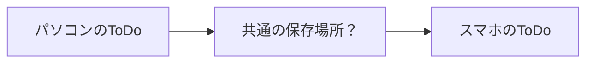

## Firebaseの中に、保存と認証のサービスがある

Firebaseは全体の名前。FirestoreとAuthenticationは、その中のサービス。

### Firebase：サービス全体の名前

- アプリ開発に使うサービス群。データ保存やログインなどの機能がそろう。
- [Firebase：公式ドキュメント](https://firebase.google.com/docs?hl=ja)

### Cloud Firestore：データを保存

- FirebaseのクラウドDB。タスクや会話履歴を保存し、端末間で同期する。
- [Firestore：公式の概要](https://firebase.google.com/docs/firestore?hl=ja)

### Firebase Authentication：ログイン

- Firebaseの認証サービス。Googleログインなどで利用者を識別する。
- [Authentication：公式の概要](https://firebase.google.com/docs/auth?hl=ja)

## localStorageとFirestore、何が違う？

保存する場所が変わると、できることが変わる

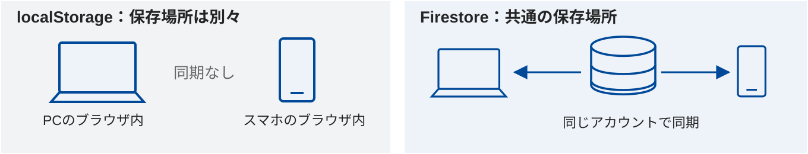

### 保存方法を比べる

| 比較すること | localStorage | Cloud Firestore |
| --- | --- | --- |
| 保存先 | その端末・そのブラウザ内（サイトごと） | クラウドのデータベース |
| 別の端末 | 自動では同期しない | 同じアプリ・アカウントで同期できる |
| ユーザーの識別 | ログイン機能は別途必要 | Authenticationと組み合わせる |

## DBとバックエンドが必要

画面の裏で、データを保存・読み書きする

### フロントエンド

- ブラウザで操作する画面。
- 入力欄・タスク一覧・完了ボタンなどを担当する。

### バックエンド＋データベース

- バックエンドは保存・取得やアクセスの制御を担当。
- DB（データベース）はタスクを整理して保存する。

### 共通の保存場所へ接続する

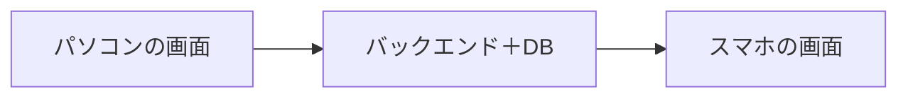

## DBにも、いくつか種類がある

DB・認証15分の中で紹介｜保存するデータの形が違う

### リレーショナルDB（RDB）

- データを表（行と列）で管理する。
- 例：MySQL、PostgreSQL。SQLという言語で読み書きする。

### ドキュメント型DB

- データを項目と値のまとまりで管理する。
- 例：Cloud Firestore、MongoDB。NoSQLと呼ばれるDBの一種。

### SQLの例：未完了のToDoを取り出す

```text
SELECT text
FROM todos
WHERE completed = false;
```

**今回はFirestoreを使う。SQLは紹介のみ。実習ではFirestoreの仕組みでデータを読み書きする。**

## Webアプリの構造を、図で見よう

元の教材の構成図｜フロントエンド・バックエンド・DB

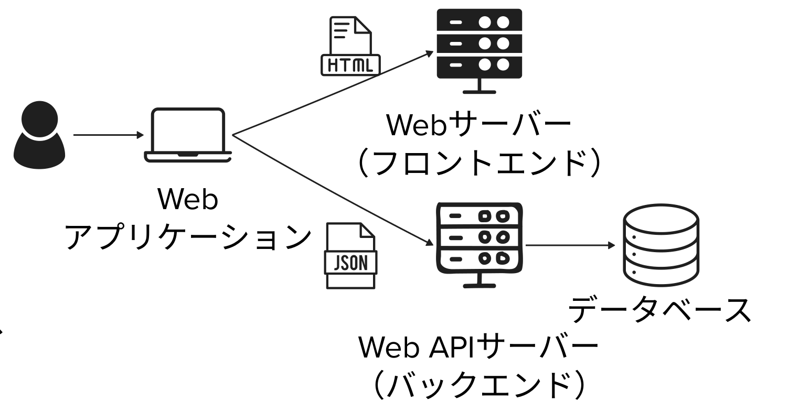

元の教材の構成図。Firebaseでは、保存・認証などのバックエンド機能をサービスとして利用する。

## APIは、画面とバックエンドをつなぐ窓口

保存・DB・認証の仕組みを知る20分の中で紹介

### 必要な情報をやり取りする

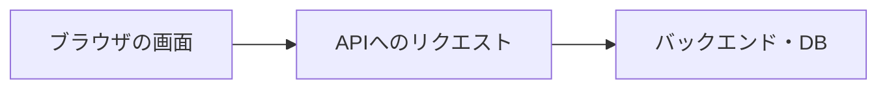

### APIとは？

- ソフトウェア同士が、決まった形で情報をやり取りするための窓口。
- タスクや会話の保存・読み出し、AIへの質問などで使う。

### 誰の、どんな操作を受け付ける？

- 送られたリクエストの認証・権限・入力内容を、受け取る側で確認する。
- Firebaseでも、認証とアクセス制御の設定が必要。

## 最近の事例：アプリからAPIを調べ、サーバーを狙う

NICTの注意喚起｜2026年10月13日公表

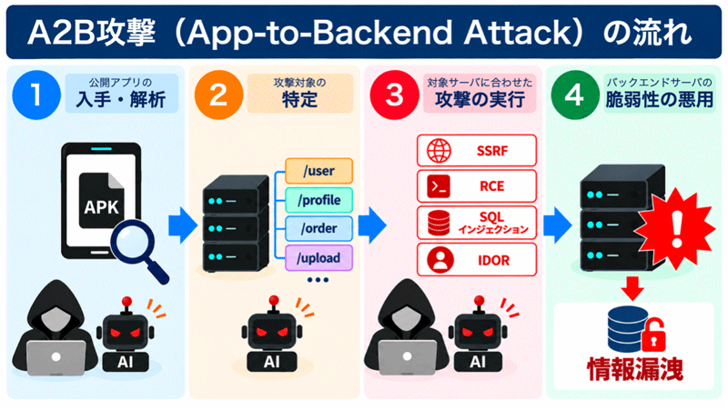

出典：NICT「A2B攻撃の流れ」。2026年10月13日は注意喚起の公表日。

### A2B攻撃（App-to-Backend）

- 公開Androidアプリを解析し、APIの接続先や仕様を調べ、バックエンドの弱点を狙う手法。
- NICTは、WebサービスのAPIでも同様の問題が起こりうるとしています。
- 授業とのつながり：画面で隠すだけでなく、保存先でも本人の権限を確認する。
- [NICTの注意喚起](https://www.nict.go.jp/press/2026/10/13-1.html)

## でも、誰のToDo？

同じDBを使うなら、個人を識別したい

### DBだけでは足りない

- 全員のタスクが同じ一覧に出てきたら困る。
- 同じ人がスマホとパソコンを使っていることも判断したい。

### データと持ち主を結びつける

- タスクに持ち主のID（userId）を記録する。
- ログインを通じて、その人のIDを確認する。

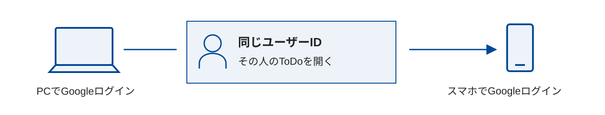

## 認証と、アクセスを許す仕組み

本人の識別と、データを守るルール

### 認証：あなたは誰？

- Googleアカウントなどでログインし、ユーザーを識別する。

### 認可：何にアクセスできる？

- 本人のタスクだけを読んだり、変更したりできるようにする。
- 画面で隠すだけでは足りない。保存先でもアクセスを制限する。
- FirestoreではSecurity Rulesを使う。他のサービスでも、権限設定やポリシーなどで誰が読み書きできるかを決める。

## 前半の折り返し

ここまで50分｜次は、ToDoにFirebaseを追加する

### ここまでの流れ

- ToDoをつくる → 端末内保存では同期できない → 共通のDBが必要。
- 個人の識別には認証、データを守るにはアクセス制御が必要。

## 今日の道順：Firebaseをつなぐ

前半100分＋後半100分｜今日の道順・いまここ

### 前半（100分）

01. 小さくつくる・仕組みを知る｜前半の最初50分：ポートフォリオ・タイマー・ToDoアプリ／保存・DB
02. **保存・同期・認証をつなぐ｜前半の次50分：クラウドDB・ログイン／同期・権限の確認（いまここ）**
### 後半（100分）

03. チャットにログインと履歴を追加｜後半の最初50分：新規作成5分／ログイン20分／履歴25分
04. チャットの改良・共有・振り返り｜後半の次50分：改良30分／紹介ページ・共有15分／まとめ5分

左を上から下へ → 休憩 → 右を上から下へ。

次にすること：ToDoにFirebaseをつなぎ、保存・同期・本人だけのアクセスを確かめる。

## ToDoにFirestoreとAuthenticationを追加

前半・次の50分｜Firebase連携25分

**課題｜つなぐ｜25分**

### 実習の3ステップ

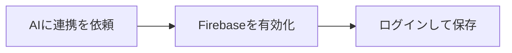

### そのまま入力できる指示例

```text
FirestoreとAuthenticationで、ログインとタスクの保存・同期を追加してください。
本人のタスクだけを読み書きできるようにしてください。
```

### AIの返答を確認

- 有効化を求められたら、画面の手順に沿って進める。

## Firebaseを有効にする

AIの案内から、連携の設定へ

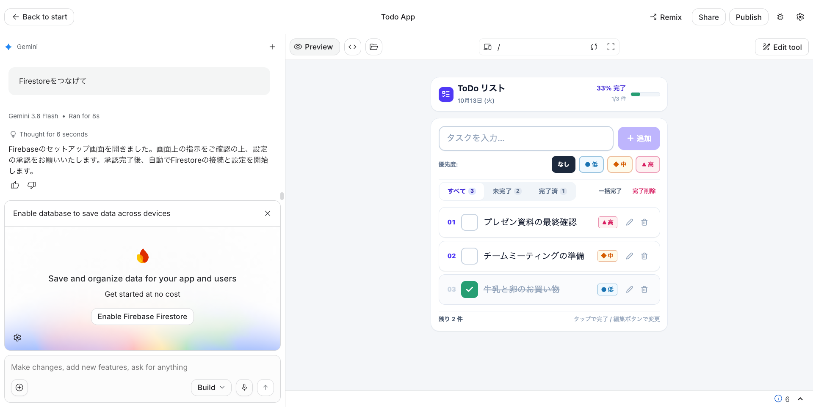

提供キャプチャ：2026年10月13日。画像はクリックで拡大。

### 画面で行うこと

- 「Enable Firebase Firestore」を選ぶ。
- 案内に沿ってプロジェクトのロケーションを選択し、利用規約を確認して同意する。
- AIが接続コードとSecurity Rulesを生成する。

## Integrationsで連携状態を確認

Firebase Firestore & Auth

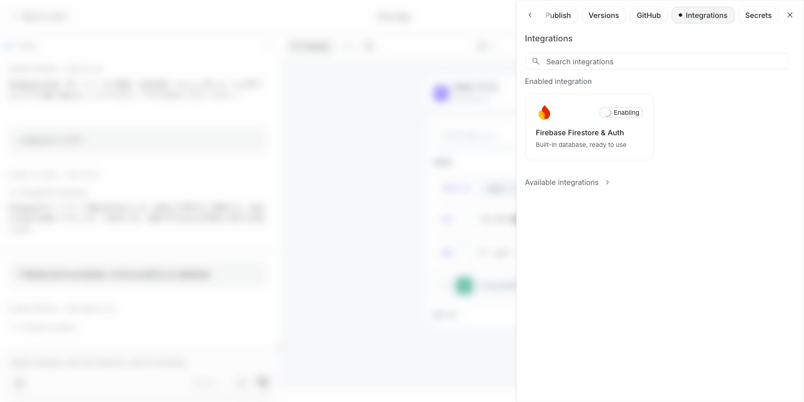

提供キャプチャ：この時点ではEnabling（有効化中）。

### 設定が終わったか確かめる

- キャプチャの「Enabling」は処理中を表す。
- 連携完了とAIの返答を確認し、アプリを試す。
- 有効化だけで満足せず、ログインと保存が動くか確認する。

## ログインして、保存・同期・権限を確かめる

同じアプリURLで、同じアカウント・別アカウント・未ログインを試す

### PCとスマホ：同じアカウント

- PCでGoogleログインし、タスクを入力する。
- スマホで同じアプリURL・同じGoogleアカウントを使い、PCのタスクが見えるか確認。
- スマホで完了にし、PCにも反映されるか確認する。
- 再読み込みしてもタスクが残るか確かめる。

### 別アカウント・未ログイン

- 別アカウントでは、先ほどのタスクが見えないか確認する。
- ログアウトし、タスクが見えず、読み書きできないか確認する。
- スマホがなければ、別ブラウザで試してもOK。
- Security Rulesでも、他人のデータへのアクセスが拒否されるか確認する。

## Firestoreの中を見てみよう

画面のタスクが、DBに保存されているか確認

**課題｜Slack投稿｜確認20分内**

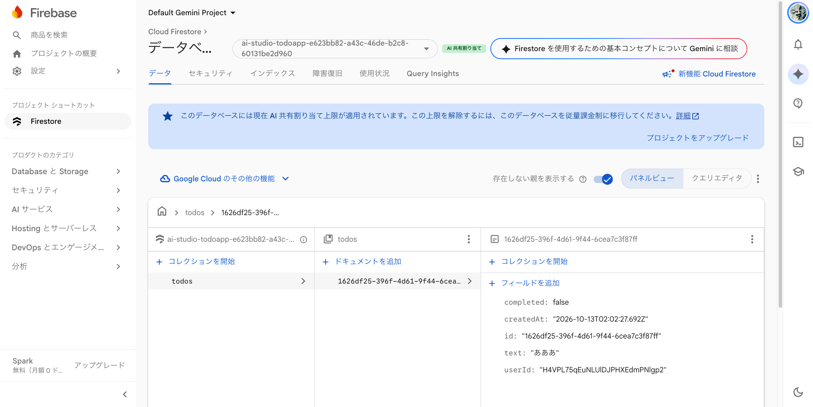

提供キャプチャ：todos内の1件。保存パス・項目名は生成結果によって異なる。

### Firestoreを開く

- [https://console.firebase.google.com/](https://console.firebase.google.com/)
- 対象のプロジェクトとDBを選び、追加したタスクを探す。
- text：内容。completed：完了。userId：持ち主。createdAt：日時。
- [Firestore：公式の概要](https://firebase.google.com/docs/firestore?hl=ja)
- Slackに投稿：DBで見つけたタスクの画面＋項目の意味を1文。

## 動かないときは、現象を伝えて直す

エラー文・操作・期待する結果をセットで伝える

### 同期できないときの指示例

```text
同じアプリ・同じアカウントなのに、PCで追加したタスクがスマホに出ません。
保存先・ログイン状態・データの取得方法を確認して修正してください。
```

### 権限エラーが出たら

- エラー文と、その直前の操作をAIに伝える。
- 認証状態・保存先・持ち主のIDとルールの対応を確認する。全員にアクセスを許可して解決しない。

## 振り返り・休憩

前半100分の最後：振り返り5分 → 休憩（別枠） → 後半へ

**課題｜Slack投稿｜5分**

### 自分の言葉で説明する

- 端末内の保存とFirestoreの保存は、何が違う？
- AuthenticationとSecurity Rulesは、それぞれ何を担当する？

### Slackに投稿する内容

```text
保存先をlocalStorageからFirestoreに変えた違い：1文
AuthenticationとSecurity Rulesの役割の違い：1文
```

## 今日の道順：チャットを育てる

前半100分＋後半100分｜今日の道順・いまここ

### 前半（100分）

01. 小さくつくる・仕組みを知る｜前半の最初50分：ポートフォリオ・タイマー・ToDoアプリ／保存・DB
02. 保存・同期・認証をつなぐ｜前半の次50分：クラウドDB・ログイン／同期・権限の確認
### 後半（100分）

03. **チャットにログインと履歴を追加｜後半の最初50分：新規作成5分／ログイン20分／履歴25分（いまここ）**
04. チャットの改良・共有・振り返り｜後半の次50分：改良30分／紹介ページ・共有15分／まとめ5分

左を上から下へ → 休憩 → 右を上から下へ。

次にすること：新しいチャットをつくり、Googleログインと会話履歴を追加する。

## 新しいチャットアプリをつくろう（先に入力）

後半の最初｜先に入力して、生成を待とう

### 新しいアプリから始める

- Google AI Studioで、新しいチャットアプリを作成する。
- 好きなテーマを決めよう。例：制作の相談、旅行、趣味。

### 新規作成の指示例

```text
〇〇をテーマに、日本語で会話できるAIチャットアプリをつくってください。
スマホでも使いやすく、自分の発言とAIの返答を区別して表示してください。
```

今は入力・送信だけ。生成を待つ間にアイスブレイクへ。画面確認・Slack投稿は後で行う。


## 午後のアイスブレイク：大学周辺のごはん屋さん

後半の最初｜新規作成・アイスブレイク5分のうち2分

**課題｜Slack投稿｜2分**

### おすすめを、ひとこと

- 大学周辺のおすすめのごはん屋さんは？

### Slackに投稿する内容

```text
おすすめのお店：〇〇
```

## アプリ開発の流れ

新規作成・アイスブレイク5分の中で｜つくって、試して、直す

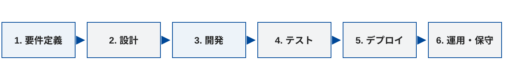

### 前半の学びを応用する

- ToDoアプリで試したFirestoreとAuthenticationを、チャットアプリにも使う。
- 画面だけでなく、ログインと会話履歴の保存・読み出しを追加する。

### AIとの対話を繰り返す

- アイデア → 生成 → 動作確認 → 不具合の説明 → 修正。
- コードや仕組みが分からなければ、AIに説明を求める。

## 新しいチャットアプリをつくろう

新規作成・アイスブレイク5分の中で｜先ほど生成したチャットを確認

**課題｜Slack投稿｜新規作成5分内**

### 生成したアプリを開く

- 先ほど生成したチャットアプリを開き、会話できるか試す。
- まだ入力していない場合だけ、テーマを決めて下の指示で生成する。

### 新規作成の指示例

```text
〇〇をテーマに、日本語で会話できるAIチャットアプリをつくってください。
スマホでも使いやすく、自分の発言とAIの返答を区別して表示してください。
```

**Slackに投稿：新しくつくったチャットの画面＋テーマを1文。**

## チャットにGoogleログインを追加しよう

後半・最初の50分｜ログイン追加20分

**課題｜Slack投稿｜ログイン20分内**

### 作成したチャットに、そのまま依頼する

```text
Firebase AuthenticationのGoogleログインを追加してください。
ログインした人だけが会話と履歴を使え、ログアウト後は非表示になるようにしてください。
```

### Slackに画面のキャプチャを投稿

- ログイン → 会話 → ログアウトを試す。
- ログイン前、またはログイン後の画面キャプチャをSlackに投稿する。

## AIと行き来しながら、改良する

元の教材の反復の図｜チャットのログイン・履歴追加でも使う

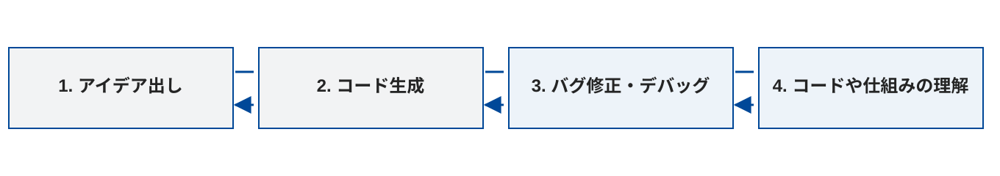

### つくって、試して、理解する

- うまく動かなければ、操作とエラーを伝えて修正する。
- 保存先やログインの仕組みが分からなければ、AIに説明を求める。

## チャットの会話履歴を保存しよう

後半・最初の50分｜履歴の追加25分

**課題｜Slack投稿｜履歴25分内**

### ログインを追加したアプリに依頼する

```text
会話履歴（自分の発言とAIの返答）をFirestoreに保存してください。
本人の履歴だけを読み書きでき、続きを話せるようにしてください。
```

### Slackに投稿する内容

- 履歴一覧と、過去の会話を開いた画面。
- Firestoreにどんな項目を保存したか、AIに確認して1文添える。

## 会話履歴は、どこに保存された？

履歴追加25分の中で確認｜表示とDBを結びつける

**課題｜Slack投稿｜履歴25分内**

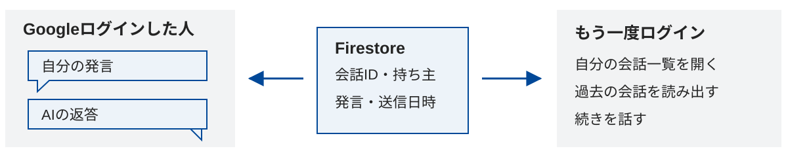

### AIに保存先を聞き、DBで見てみよう

- 会話が保存されるコレクション・ドキュメントと、持ち主のIDをAIに確認する。
- Firebaseコンソールで、自分の発言とAIの返答が保存されているか確認する。

**Slackに投稿：保存先と、本人の履歴を取り出す方法を1文ずつ。**

## ログインと履歴の基本動作を確かめる

ログイン20分・履歴25分の中で｜追加と同時に動かして確認

**課題｜Slack投稿｜追加作業の時間内**

### 履歴が残る？　続きから話せる？

- 会話した後に再読み込みし、履歴を開く。
- ログアウト → 同じアカウントで再ログインし、履歴を確認する。
- 別端末・別ブラウザでも同じアカウントで開き、続きを話す。
- Slackに投稿：確認した操作と結果を各1行。

### 他の人の履歴は見えない？

- 別アカウントと未ログインでは、本人の履歴が見えないことを確認する。
- Security RulesもAIに説明させ、他人の履歴へのアクセスが拒否されるか確認する。
- Slackに投稿：確認できた結果と、未確認の点。

## 後半の折り返し

ここまで50分｜次は、チャットを使いやすくして共有する

### ここまでの成果

- 新しいチャットアプリに、ログインと会話履歴を追加した。
- 残り50分は、使いやすさの改良と、成果の共有に使う。

## 今日の道順：改良して共有する

前半100分＋後半100分｜今日の道順・いまここ

### 前半（100分）

01. 小さくつくる・仕組みを知る｜前半の最初50分：ポートフォリオ・タイマー・ToDoアプリ／保存・DB
02. 保存・同期・認証をつなぐ｜前半の次50分：クラウドDB・ログイン／同期・権限の確認
### 後半（100分）

03. チャットにログインと履歴を追加｜後半の最初50分：新規作成5分／ログイン20分／履歴25分
04. **チャットの改良・共有・振り返り｜後半の次50分：改良30分／紹介ページ・共有15分／まとめ5分（いまここ）**

左を上から下へ → 休憩 → 右を上から下へ。

次にすること：チャットを改良し、動作確認の結果と成果を共有する。

## チャットを、もっと使いやすくしよう

後半・次の50分｜改良30分

**課題｜Slack投稿｜改良30分内**

### 会話する画面を改良

- 文字の大きさ、送信ボタン、スマホでの操作性を見直す。
- テーマに合う見た目や、AIの返答の仕方を工夫する。
- Slackに投稿：改良した画面＋何を変えたか1文。

### 履歴の使いやすさを改良

- 会話のタイトルや並び順、過去の会話の開きやすさを見直す。
- 1つずつ改良し、保存・ログインが引き続き動くか確認する。
- Slackに投稿：改良後の画面＋使いやすくなった点。

## ログイン前のトップページで、機能を紹介しよう

後半・次の50分｜トップページ作成・共有15分

**課題｜作成・Slack投稿｜15分**

### 作成したアプリのAI Studioで依頼する

```text
このアプリに、ログイン前に表示するトップページを追加してください。
アプリ名・誰の何を助けるか・主な機能3つ・使い方を紹介してください。
Googleログインのボタンを置き、ログイン後はチャットと履歴を使えるようにしてください。
実装済みの機能だけを書き、既存のログイン・履歴の動作を保ってください。
```

### 紹介文を、自分の言葉で見直す

- 誰の、どんな場面で役立つ？
- 実際に使える機能が伝わる説明にする。

### Slackに投稿して紹介

- トップページの画面＋紹介文を1文。
- ログイン → 会話 → 履歴の動作も確認する。

## 画面から、使い続けられるアプリへ

後半・次の50分｜まとめ5分

### 今日の学び

- フロントエンド：操作する画面。
- Cloud Firestore：データを保存・同期する。
- Firebase Authentication：ログインで本人を識別する。
- Security Rules：誰が読み書きできるかを制御する。

### 次回につなげる

- チャットアプリを実際に使い、履歴や会話の続けやすさを改良する。
- 生成AIの出力は、動かして確かめる。
- [Firebase公式ガイド](https://firebase.google.com/docs/ai-assistance/ai-studio-integration?hl=ja)

## 参考資料

- [NICT：A2B攻撃の注意喚起（2026年10月13日公表）](https://www.nict.go.jp/press/2026/10/13-1.html)
- [Firestore：公式の概要](https://firebase.google.com/docs/firestore?hl=ja)
- [Authentication：公式の概要](https://firebase.google.com/docs/auth?hl=ja)
- [Firebase：AI Studioとの連携](https://firebase.google.com/docs/ai-assistance/ai-studio-integration?hl=ja)
- [Firebase：Security Rules](https://firebase.google.com/docs/rules?hl=ja)
- [他サービスの例：SupabaseのRow Level Security](https://supabase.com/docs/guides/database/postgres/row-level-security)

Security RulesはFirebaseの仕組みで、Firestoreで使うアクセス制御の方法です。他サービスでは名称・設定方法が異なりますが、「誰がどのデータを読み書きできるか」を制御する考え方は共通します。例えばSupabaseは、PostgreSQLの行レベルセキュリティ（RLS）とポリシーを使います。
