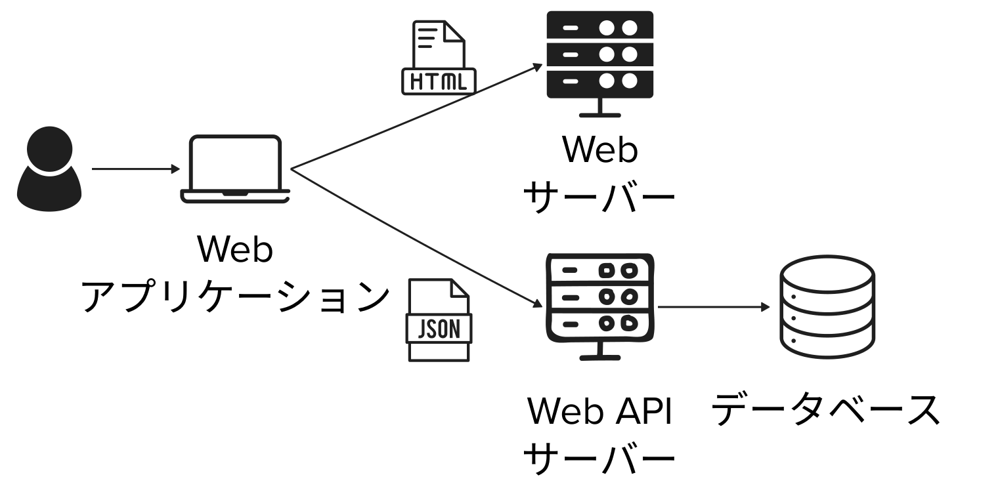
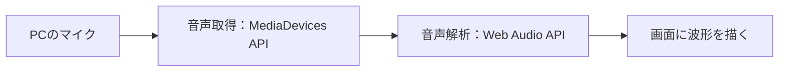
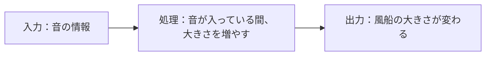
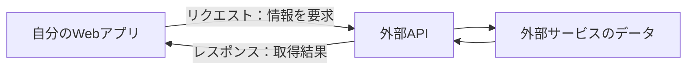

# プロンプトエンジニアリング ~ アプリケーション開発 ② ~

2026年度・第5回｜2026年10月23日｜プログラミング演習

[スライドを開く](index.html)


授業イメージ：既存の授業資料に収録された生成AIによるイラスト。

| 回数 | 1<br />(9/25) | 2<br />(10/2) | 3<br />(10/9) | 4<br />(10/16) | **5<br />(10/23)** | 6<br />(11/6) | 7<br />(11/13) |
| --- | :---: | :---: | :---: | :---: | :---: | :---: | :---: |
| テーマ | AI 基礎 | プロンプトエンジニアリング | AI の活用と倫理 | AI を活用したアプリ生成 ① | **AI を活用したアプリ生成 ②** | 総合演習 | 総合演習 |
| 担当講師 | 伊藤、髙田 | 髙田 | 伊藤 | 伊藤 | **髙田** | 髙田、伊藤 | 伊藤、髙田 |

### 目次

[TOC]

## 3限・前半（0〜50分）

## 1. 復習と今日のゴール（23分）

#### 今日の道順（2分｜0〜2分）

| 順番 | 時間（授業開始から） | テーマ | 主な活動・成果 |
| --- | --- | --- | --- |
| **01** | 3限・前半のうち（0〜23分） | **復習と今日のゴール（いまここ）** | Webアプリの構造と今日の進め方を確認 |
| 02 | 3限・前半のうち（23〜50分） | ① 入力の幅を広げる | アプリA：マイクの音を波形にする |
| 03 | 3限・後半（50〜100分） | ② 表現の幅を広げる：反応 | アプリAを改良：音と操作の反応を作り、調整する |
| 04 | 4限・前半（100〜150分） | ② 表現の幅を広げる：見た目と動き | アプリB：自分の素材で見た目と動きを調整する |
| 05 | 4限・後半のうち（150〜193分） | ③ データの幅を広げる | アプリC：外部APIの情報を表示する |
| 06 | 4限・後半のうち（193〜200分） | まとめと宿題 | 自由制作のアイデアを3案以上記録する |

次にすること：前回の制作を振り返り、今日広げる3つの方向を確認します。

授業は100分×2コマです。コマ間の休憩は200分に含みません。アプリAは3限で続けて改良し、4限のアプリB・Cはそれぞれ新しく作ります。

### 1-1. アイスブレイク（5分｜2〜7分）

#### 最近おいしかったものは？（5分｜2〜7分）

**課題｜Slack投稿｜5分（投稿・リアクションを含む）**

最近食べておいしかったものを、ひとこと教えてください。お店の料理でも、コンビニのおやつでも、自分で作ったものでもOKです。

**投稿するもの**：最近おいしかったものを1つ、短文で投稿します。

投稿例：

```text
最近おいしかったもの：コンビニのかぼちゃプリン
```

投稿したら、ほかの人の投稿にもリアクションしてみましょう。

### 1-2. 前回の復習（14分｜7〜21分）

#### 前回の道順（1分｜7〜8分）

まず、[前回の道順](../4_webapp_dev_with_ai/readme.md)を振り返りましょう。

| 順番 | 前回の道順 | やったこと |
| --- | --- | --- |
| 01 | 小さくつくる・仕組みを知る | ポートフォリオ・タイマー・ToDoを作り、保存やDBの役割を知る |
| 02 | 保存・同期・認証をつなぐ | ToDoにFirestoreとログインを追加し、同期と権限を確認する |
| 03 | チャットにログインと履歴を追加 | 新しいチャットを作り、ログインと会話履歴の保存を追加する |
| 04 | チャットの改良・共有・振り返り | 使いやすく改良し、紹介ページを作って共有する |

#### Webアプリの基本構造（1分｜8〜9分）



図：第4回「Webアプリの構造を、図で見よう」で使用した構成図。次の2つの演習でも同じ図を使います。

#### 復習クイズ1：図の各要素は、何を担当している？（3分｜9〜12分）

**クイズ｜Slack投稿｜3分（考える・投稿する時間を含む）**

各要素の役割を、選択肢から選びましょう。

**図の要素**

- A：Webアプリケーション
- B：Webサーバー
- C：Web APIサーバー
- D：データベース

**選択肢（順不同）**

1. データを整理して保存する
2. ブラウザに表示するHTMLなどを配信する
3. 利用者が操作する画面や機能を提供する
4. リクエストを受け取り、必要な処理を行う

**投稿するもの**：A〜Dそれぞれに対応する選択肢の番号。

投稿例（○を番号に置き換える）：

```text
演習①
A：○、B：○、C：○、D：○
```

#### 復習クイズ2：前回使った技術は、図のどこにある？（4分｜12〜16分）

**クイズ｜Slack投稿｜4分（考える・投稿する時間を含む）**

同じ図を使って、次の技術・サービスがどの位置や役割に関係するか考えましょう。

- Google AI Studio
- ToDoアプリ・チャットアプリ
- Cloud Firestore
- Firebase Authentication
- Security Rules

**すべてが図の中の箱に収まるだろうか？**

**投稿するもの**：5つの技術・サービスの位置づけを各1行。箱に収まらないと思ったものには、理由をひとこと添えましょう。位置づけが分かるように書き込んだ図の画像でもOKです。

投稿例（○○を自分の考えに置き換える）：

```text
演習②
Google AI Studio：○○
ToDoアプリ・チャットアプリ：○○
Cloud Firestore：○○
Firebase Authentication：○○
Security Rules：○○
```

<!--
講師メモ：答え合わせと今回への接続（3分｜16〜19分）
前回の道順1分＋構成図1分＋演習①3分＋演習②4分＋答え合わせ3分＋開発の流れ2分＝14分。
演習①・②は、それぞれ考える時間とSlack投稿を含む。両演習で同じ構成図を使う。

**演習①：A＝3、B＝2、C＝4、D＝1。**

**演習②：対応の考え方**

| 技術・サービス | 図への対応 | 前回の役割 |
| --- | --- | --- |
| Google AI Studio | 図全体を作る・改良する道具。実行時の箱には収まらない | AIに指示してアプリを生成・修正する |
| ToDoアプリ・チャットアプリ | 操作する画面はA。保存・ログインを含むアプリ全体は複数の役割にまたがる | タスク管理や会話をする |
| Cloud Firestore | Dのデータベースに対応。保存・取得の機能もサービスとして提供する | タスク・会話履歴の保存と同期 |
| Firebase Authentication | C側のバックエンド機能に関係する。データベースそのものではない | ログイン・本人の識別 |
| Security Rules | Firestoreへの読み書きを制御するルール。独立したサーバーではない | 誰がどのデータにアクセスできるかを決める |

右側のバックエンドの役割を、前回はFirebaseのサービスに任せました。図は一般的な役割を示しているので、各サービスが箱に1対1で対応するとは限りません。自分でWeb APIサーバーを作らなくても、画面からFirebaseの機能を利用できます。

**今回への問い：「マイクはこの構造のどこにつながる？」**

利用者側のPCやスマホにつながり、その音の情報をブラウザで動くWebアプリへ取り込めます。今日は、ここから入力の幅を広げます。

-->

#### AIと行き来しながら、改良する（2分｜19〜21分）

前回の「AIと行き来しながら、改良する」で見た図を振り返りましょう。


図：第4回のスライド「AIと行き来しながら、改良する」から再掲。

- アイデア → 生成 → 動作確認 → 不具合の説明 → 修正。
- うまく動かなければ、操作とエラーを伝えて修正する。
- コードや、保存・ログインの仕組みが分からなければ、AIに説明を求める。

今回も、作って終わりにせず、試す・直す・理解することを行き来しながら改良します。

### 1-3. 今日のゴール（2分｜21〜23分）

#### 作れるWebアプリの幅を広げよう（2分｜21〜23分）

前回は、Webアプリの基本構造を学び、保存・同期・ログインを追加しました。

今回は、入力・表現・データの3つを工夫して、AIと作れるWebアプリの幅を広げます。

| 工夫ポイント | 問い | 今日試すこと |
| --- | --- | --- |
| ① 入力 | 何を受け取れる？ | マイクやデバイスの情報 |
| ② 表現 | どう反応する？ どう見せる？ | 入力・処理・出力の設計、画像素材 |
| ③ データ | どんな情報を使える？ | 外部APIからのデータ取得 |

<!-- 講師メモ：images/backend_2.pngは未作成。元の構成図に、①利用者側の入力、②画面の反応・表現、③外部APIのデータを描き足した図をここに掲載する。 -->


## 2. 入力の幅を広げる（27分）

#### 今日の道順（1分｜23〜24分）

| 順番 | 時間（授業開始から） | テーマ | 主な活動・成果 |
| --- | --- | --- | --- |
| 01 | 3限・前半のうち（0〜23分） | 復習と今日のゴール | Webアプリの構造と今日の進め方を確認 |
| **02** | 3限・前半のうち（23〜50分） | **① 入力の幅を広げる（いまここ）** | アプリA：マイクの音を波形にする |
| 03 | 3限・後半（50〜100分） | ② 表現の幅を広げる：反応 | アプリAを改良：音と操作の反応を作り、調整する |
| 04 | 4限・前半（100〜150分） | ② 表現の幅を広げる：見た目と動き | アプリB：自分の素材で見た目と動きを調整する |
| 05 | 4限・後半のうち（150〜193分） | ③ データの幅を広げる | アプリC：外部APIの情報を表示する |
| 06 | 4限・後半のうち（193〜200分） | まとめと宿題 | 自由制作のアイデアを3案以上記録する |

次にすること：マイクの音を波形にするアプリAを作ります。

### 2-1. 端末とセンサー（22分｜24〜46分）

#### アプリは、クリック以外に何を受け取れる？（1分｜24〜25分）

これまでは、文字の入力やクリックでアプリを操作しました。マイクの音や端末の動きも、アプリへの入力として使えます。

| 入力の例 | アプリでできることの例 |
| --- | --- |
| マイクの音 | 音の大きさで画面を変える |
| カメラの映像 | 撮影した映像を画面に表示する |
| 端末の傾き・動き | 端末を傾けて操作する |

#### まずはPCで、音を入力してみよう（1分｜25〜26分）

センサーは、音・光・動きなど、身の回りの情報を受け取る装置です。PCにも、マイクやカメラなどの入力装置があります。

| PCの入力装置 | 受け取る情報 | 身近な利用例 |
| --- | --- | --- |
| マイク | 音 | オンライン会議、録音 |
| カメラ | 映像 | ビデオ通話、写真撮影 |

今回は、PCのマイクから受け取った音を波形として表示します。

#### 演習：声を出すと、波形はどう変わる？（15分｜26〜41分）

**演習｜制作・動作確認・Slack投稿｜15分（説明2分＋制作10分＋確認・投稿3分）**

Google AI Studioで新しいアプリAを作り、次の指示を入力しましょう。

```text
PCのマイクから入力された音をリアルタイムで可視化するWebアプリを作ってください。
マイクの開始・停止ボタンを用意し、音声の波形を画面に表示してください。
マイクの使用許可がない場合や利用できない場合には、状態が分かるメッセージを表示してください。
音声を録音・保存・外部送信する必要はありません。ブラウザ内で処理してください。
```

**完了の目安**：マイクを許可して開始すると、声や音に応じて波形が変わる。停止ボタンでマイクの使用を終了できる。

**投稿するもの**：アプリAの画面。投稿時間は演習の15分に含みます。

動かない場合は、マイクの接続、OS・ブラウザの使用許可、実行先がHTTPSかを確認しましょう。プレビューで権限エラーが出たら、その直前の操作とエラー文を記録して教員に相談します。

未完成でも、画面＋「試した操作・起きたこと・エラー」を投稿してOKです。マイクが使えない場合は、教員のデモで動きを確認しましょう。

<!-- 講師メモ：開始・停止時のマイク使用表示も確認する。動かない学生は権限・接続・プレビューの制約を確認し、時間内に解決しなければデモへ切り替える。音声を外部送信していないか、生成コードでも確認する。 -->

#### スマホなら、傾きや移動も入力にできる？（1分｜41〜42分）

スマホは持ち歩くので、動きや位置に関する情報が身近です。

| センサー・機能の例 | 受け取る情報 | 入力として使うアイデア |
| --- | --- | --- |
| 加速度センサー | 動きの変化 | 振ると絵柄が変わる |
| ジャイロセンサー | 回転の動き | 傾けてボールを転がす |
| 位置情報の取得機能 | 現在地 | 近くの場所を案内する |

機種によって搭載するセンサーは異なります。ここではアイデアの紹介にとどめ、実装は行いません。

#### クイズ：スマホは、どうやって歩数を数える？（2分｜42〜44分）

**クイズ｜Slack投稿｜2分（考える・投稿する時間を含む）**

**スマホで歩数を数えるとき、主にどの情報を使っているでしょう？**

1. GPSによる現在地の変化
2. 加速度センサーによる体の動き
3. 時計で測った経過時間

**投稿するもの**：選んだ番号を1つ。余裕があれば、理由もひとこと添えましょう。

投稿例（○を番号に置き換える）：

```text
クイズ：○番
```

<!-- 解答：2。加速度センサーで捉えた動きのパターンから歩数を推定する。講師メモ：答え合わせでは「その場で足踏みしたとき、現在地が変わらなくても歩数を数えられるのはなぜ？」と問いかける。実際の判定方法や精度は端末・アプリによって異なり、足踏みで必ずカウントされるとは説明しない。GPSは移動経路や距離の記録に使われることがある。 -->

#### 腕に着けると、どんな入力が身近になる？（2分｜44〜46分）

スマートウォッチは体に着けて使うため、日常の動きや体の状態に関する情報を扱いやすくなります。

| センサーの例 | 受け取る情報 | 利用例 |
| --- | --- | --- |
| 加速度・ジャイロセンサー | 腕や体の動き | 歩数や運動の記録に利用する |
| 光学式心拍センサー | 光を使って捉えた血流の変化 | 心拍数の推定に利用する |

**端末が測れることと、Webアプリから使えることは別です。** ウォッチの情報を使うには、専用アプリやサービスとの連携が必要な場合があります。今回は仕組みと応用例の紹介です。

<!-- 講師メモ：端末ごとの特徴を伝え、PC→スマホ→ウォッチの順でセンサー数が増えるとは説明しない。搭載状況は機種による。心拍数や歩数はセンサーの情報を処理して求める値。ウォッチのデータ取得を、この授業のブラウザだけで実行できるようには説明しない。 -->

### 2-2. 入力を取得する仕組み（4分｜46〜50分）

#### マイクの音は、どうやって画面に届いた？（4分｜46〜50分）



図：アプリAで、マイク入力を波形表示に使うまでの流れ。

- **API**：用意された機能やデータを、プログラムから利用するための窓口。
- **MediaDevices API**：利用者の許可を得て、マイクやカメラの入力を取得する。
- **Web Audio API**：音声を解析・処理する。今回は波形の値を表示に使う。

AIがマイクの音を聞いて描いているのではなく、生成されたアプリがブラウザのAPIを使っています。

スマホの動きなどは別のAPIで扱います。利用できる機能は端末・OS・ブラウザ・権限によって異なり、すべてのセンサーを同じ方法で使えるわけではありません。

参考：[MDN：getUserMedia](https://developer.mozilla.org/ja/docs/Web/API/MediaDevices/getUserMedia)、[MDN：Web Audio API](https://developer.mozilla.org/ja/docs/Web/API/Web_Audio_API)、[MDN：Sensor APIs](https://developer.mozilla.org/en-US/docs/Web/API/Sensor_APIs)、[Apple：HealthKit](https://developer.apple.com/documentation/healthkit)

<!-- 講師メモ：マイク取得のコード例はnavigator.mediaDevices.getUserMedia()。MediaDevices APIと、加速度などを扱うGeneric Sensor APIは別の仕組み。API名の暗記を求めず、「許可を得て入力を取得し、処理して表示する」という流れを確認する。 -->

## 3限・後半（50〜100分）

## 3. 表現の幅を広げる：反応を設計する（50分）

#### 今日の道順（1分｜50〜51分）

| 順番 | 時間（授業開始から） | テーマ | 主な活動・成果 |
| --- | --- | --- | --- |
| 01 | 3限・前半のうち（0〜23分） | 復習と今日のゴール | Webアプリの構造と今日の進め方を確認 |
| 02 | 3限・前半のうち（23〜50分） | ① 入力の幅を広げる | アプリA：マイクの音を波形にする |
| **03** | 3限・後半（50〜100分） | **② 表現の幅を広げる：反応（いまここ）** | アプリAを改良：音と操作の反応を作り、調整する |
| 04 | 4限・前半（100〜150分） | ② 表現の幅を広げる：見た目と動き | アプリB：自分の素材で見た目と動きを調整する |
| 05 | 4限・後半のうち（150〜193分） | ③ データの幅を広げる | アプリC：外部APIの情報を表示する |
| 06 | 4限・後半のうち（193〜200分） | まとめと宿題 | 自由制作のアイデアを3案以上記録する |

次にすること：音と操作のアイデアをそれぞれ試し、反応を調整します。

### 3-1. 反応の仕組み（7分｜51〜58分）

#### 同じ音でも、違う反応を作れる？（7分｜51〜58分）

アプリAを続けて改良します。例として、マイクに向かって「ふーっ」と吹くと、風船が少しずつ大きくなるインタラクションを取り上げます。同じ入力でも、処理と出力を変えると体験が変わります。

| アプリ | 入力：何を受け取る？ | 処理：どう扱う？ | 出力：何が変わる？ |
| --- | --- | --- | --- |
| 音声波形 | マイクの音声 | 波形の値を取り出す | 波形を描く |
| 風船 | 「ふーっ」と吹く音 | 一定以上の音が入っている間、大きさを少しずつ増やす | 息を吹くと風船が膨らむ |



図：音の強さを画面の変化に変換する例。マイクで直接「息の量」を測っているわけではありません。

### 3-2. 反応のアイデアと実装（32分｜58〜90分）

#### 演習①：音で何を変化させる？（5分｜58〜63分）

**演習｜アイデア・Slack投稿｜5分（投稿時間を含む）**

アプリAの音声入力を使って、何をどう変化させるか考えましょう。ここでは「ふーっと吹くと風船が膨らむ」を例にします。自分の案で進めてもOKです。

| 反応の工夫 | アイデアの例 |
| --- | --- |
| 対応させる | 音が大きいほど風船が大きくなる |
| ためる | ふーっと吹くたびに風船が少しずつ膨らみ、大きさを保つ |
| 境目で切り替える | 大きな音がしたら画面の色が変わる |
| 遅らせる | 音が止まって少ししてから光が消える |
| なめらかにする | 音に合わせて、ゆっくり形が変わる |

**完了の目安**：音を使う反応を1つ決め、入力・処理・出力で説明できる。

**投稿するもの**：入力・処理・出力を各1行。

投稿例：

```text
入力：マイクに向かって「ふーっ」と吹く音
処理：一定以上の音が入っている間、風船の大きさを少しずつ増やす
出力：吹くたびに風船が膨らみ、吹くのをやめても大きさが残る
```

#### 演習②：考えた反応をアプリAで試そう（10分｜63〜73分）

**演習｜アプリAの改良・動作確認・Slack投稿｜10分（投稿時間を含む）**

波形表示を残し、考えた反応を追加しましょう。指示例の対象や変化は、自分の案に置き換えます。

```text
今ある音声波形アプリの機能を残し、画面に風船を追加してください。
マイクに向かって「ふーっ」と吹くと、その音に反応して風船が少しずつ大きくなるようにしてください。
吹くのをやめたら、その大きさを保ってください。マイクを停止している間は膨らまないようにしてください。
画面からはみ出さない最大サイズと、最初の大きさに戻すリセットボタンを用意してください。
```

**完了の目安**：音の変化で、波形以外のオブジェクトも変化する。マイクを停止したときの表示も確認する。

**投稿するもの**：アプリ画面＋音によって何が変化したかを1文。

投稿例：

```text
ふーっと吹くと風船が膨らみ、吹くのをやめても大きさが残りました。
```

未完成の場合は、試した指示と、できたこと・困っていることを投稿します。

#### 演習③：クリック・ドラッグ・スクロールで何を変える？（5分｜73〜78分）

**演習｜アイデア・Slack投稿｜5分（投稿時間を含む）**

音への反応に別の操作を1つ追加するとしたら、どんな体験にできるでしょう？

| 追加する入力 | 反応の例 |
| --- | --- |
| クリック | 風船の色を切り替える、風船を割る |
| ドラッグ | 風船を好きな位置に動かす |
| スクロール | 背景を昼から夜へ変える、風船の高さを変える |

**完了の目安**：追加する入力と変化を1組決める。

**投稿するもの**：追加する入力と、それによる変化を各1行。

投稿例：

```text
追加する入力：風船をドラッグする
変化：風船を好きな位置に動かす。息を吹くと膨らむ反応は残す。
```

#### 演習④：音と操作を組み合わせて試そう（12分｜78〜90分）

**演習｜アプリAの改良・動作確認・Slack投稿｜12分（投稿時間を含む）**

選んだ操作を追加し、音への反応と、追加した操作への反応を両方試しましょう。

```text
音声波形と、ふーっと吹くと風船が膨らむ機能を残してください。
風船をドラッグして好きな位置に移動できるようにしてください。
移動した後も、息を吹くと膨らむようにしてください。
```

**完了の目安**：音と、クリック・ドラッグ・スクロールなどの操作で、それぞれの反応を確認できる。

**投稿するもの**：アプリ画面＋それぞれの入力で何が変わるかを1文。

投稿例：

```text
ふーっと吹くと風船が膨らみ、ドラッグで好きな位置に動かせます。
```

スクロールで変化しにくい場合は、画面の構成を確認するか、クリック・ドラッグに切り替えてもOKです。

<!-- 講師メモ：反応の例はアイデアを広げるための選択肢として紹介し、風船は一連の演習をつなぐ説明例とし、全員の制作対象を限定しない。各自のアイデアをアプリAで実装する。生成・修正に時間がかかる場合は、機能を1つに絞り、後の調整時間も使って基本動作の確認を優先する。 -->

#### 演習⑤：試して、気になる反応を1つ直そう（10分｜90〜100分）

**演習｜操作・調整・再確認｜10分（Slack投稿なし）**

作ったアプリを操作して、反応しすぎる・動きが速すぎる・操作しにくいところがないか確かめましょう。

| 試して気づいたこと | 調整の例 |
| --- | --- |
| 周囲の小さな音にも反応する | 一定以上の音にだけ反応させる |
| 変化が速すぎる | 変化量や、変化する速さを小さくする |
| 細かく震える | 音の値をならして、変化をなめらかにする |
| クリックやドラッグがしにくい | 操作する範囲を広げる |
| 一度動かすと試し直せない | リセットする操作を用意する |

気になる点を1つ選び、AIに調整を依頼しましょう。

```text
周囲の小さな物音だけでも風船が膨らんでしまいます。
ある程度大きな音にだけ反応するように調整してください。
反応し始める音の大きさを画面のスライダーで調整できるようにしてください。
波形表示と、風船をドラッグで移動する機能は残してください。
```

**完了の目安**：1点以上調整し、同じ操作をもう一度試して調整前後の違いを確認できる。音と追加操作の両方が引き続き動く。

**提出物**：なし。投稿せずに、動作確認と調整に時間を使いましょう。

<!-- 講師メモ：満足している学生も、変化の速さや反応し始める音の大きさを変えて比較する。マイクが使えない場合は教員デモを見て調整案を考える。100分で3限終了。休憩は別枠で、4限は新しいアプリBへ進む。 -->


## 4限・前半（100〜150分）

## 4. 表現の幅を広げる：意図した見た目と動きに近づける（50分）

#### 今日の道順（1分｜100〜101分）

| 順番 | 時間（授業開始から） | テーマ | 主な活動・成果 |
| --- | --- | --- | --- |
| 01 | 3限・前半のうち（0〜23分） | 復習と今日のゴール | Webアプリの構造と今日の進め方を確認 |
| 02 | 3限・前半のうち（23〜50分） | ① 入力の幅を広げる | アプリA：マイクの音を波形にする |
| 03 | 3限・後半（50〜100分） | ② 表現の幅を広げる：反応 | アプリAを改良：音と操作の反応を作り、調整する |
| **04** | 4限・前半（100〜150分） | **② 表現の幅を広げる：見た目と動き（いまここ）** | アプリB：自分の素材で見た目と動きを調整する |
| 05 | 4限・後半のうち（150〜193分） | ③ データの幅を広げる | アプリC：外部APIの情報を表示する |
| 06 | 4限・後半のうち（193〜200分） | まとめと宿題 | 自由制作のアイデアを3案以上記録する |

次にすること：見た目と動きを考え、手描きかAIで素材を作り、アプリBで試して調整します。

### 4-1. 表現の具体化（6分｜101〜107分）

#### 自分の絵が、音や操作に反応したら？（6分｜101〜107分）

第2章ではマイクなどの入力を、第3章では入力に応じた反応の作り方を試しました。今度はそれらを応用し、自分で用意した画像を使って、**より意図通りのアプリを作るテクニック**を練習しましょう。

まずは、画像と反応を組み合わせた例を見てみましょう。

| 表現の例 | 入力 | 起こること | 使う画像素材 |
| --- | --- | --- | --- |
| 息で飛ばすたんぽぽ | マイクに「ふーっ」と吹く | 綿毛がふわっと舞い、ゆっくり落ちる | 綿毛1つの絵 |
| 触ると広がる水面 | クリック・ドラッグ | 触った場所から波紋が重なって広がる | 水面の背景画 |
| スクロールで変わる空 | スクロール | 空が昼から夕方、夜へ変わり、星が現れる | 空や雲、星の絵 |

**同じ画像でも、どんな入力にどう反応するかで、体験が変わります。**

ここからは、新しいアプリBを作ります。手描きでもAIで作った画像でもOKです。素材1枚と反応1つから始めましょう。

<!-- 講師メモ：上の3つは授業用デモの案で、既存作品の引用ではない。授業前に1〜2例の動作デモを用意し、静止画の状態と入力後の変化を見せる。入力・反応・画像素材の関係を確認する。デモは未作成。画像生成の技法や3D表現の紹介を主題にせず、学生が自分が試したい見た目や動きを考えるきっかけにする。 -->

#### 演習①：どんなインタラクティブアートを作成する？（8分｜107〜115分）

**演習｜アイデア・Slack投稿｜8分（投稿時間を含む）**

どんな見た目で、どう反応してほしいか考えましょう。**題材・入力・反応・必要な画像**をセットで決めます。

迷ったら、自然の形や動きから発想してみましょう。自然以外の題材でも構いません。

| 発想のきっかけ | どんな動きや変化がある？ |
| --- | --- |
| 風・綿毛・落ち葉 | 舞う、揺れる、集まる、散らばる |
| 水・雨 | 波紋が広がる、落ちる、たまる |
| 花・植物 | 育つ、開く、しおれる |
| 空・光・星 | 色が変わる、明滅する、流れる |

**完了の目安**：入力と反応を1組決め、そのために用意する画像が分かる。

**投稿するもの**：題材・入力・反応・必要な画像を各1行。

投稿例：

```text
題材：風に舞うたんぽぽの綿毛
入力：マイクにふーっと吹く
反応：吹くと綿毛が舞い上がり、音が止まるとゆっくり落ちる
必要な画像：たんぽぽの絵。余裕があれば綿毛1本も用意する
```

#### 演習②：アプリに使う画像を、描くかAIで作ろう（15分｜115〜130分）

**演習｜素材制作・確認・Slack投稿｜15分（投稿時間を含む）**

全部を一度に作るより、要素を別々に作って組み合わせると、イメージに近づけやすいことがあります。

そのため、ここでは自分のアイデアに必要な画像を用意しましょう。次の方法から選んでも、組み合わせてもOKです。

| 作り方 | 進め方 |
| --- | --- |
| 自分で描く | 描画アプリで描いて保存する。紙に描いて撮影してもOK |
| AI（Gemini、ChatGPTなど）で作る | まず描いてほしいものを伝え、生成結果を見て必要なところを直す |
| 過去の自作を参考にAIで作る | 自分が描いた絵を添付し、色使い・線・質感などのテイストを生かして、別の題材を描いてもらう |

AI（Gemini、ChatGPTなど）で作る場合の指示例：

```text
息を吹くと綿毛が飛ぶWebアプリに使う、たんぽぽの絵を描いてください。

綿毛がついたたんぽぽを、和紙に淡い水彩で描いたような雰囲気にしてください。
紙の繊維やにじみが少し感じられ、輪郭はやわらかくしてください。
白い綿毛が見えるように、背景はくすんだ淡い青にしてください。
たんぽぽ全体が画面に収まる、余白のある構図にしてください。
文字は入れないでください。
```

過去の自作を使う場合の指示例：

```text
添付した自分の絵の色使い・線・質感を参考に、たんぽぽの絵を描いてください。
題材は変えつつ、元の絵のテイストを生かしてください。
```

出てきた画像を見て、「紙の質感をもう少し強く」「背景をもう少し淡く」など、自分のイメージに合わせて調整しましょう。

余裕があれば、動かす要素（例：綿毛1本）の画像も別に用意すると、組み合わせて使いやすくなります。生成した画像を添えて、同じ画風で作るように伝えましょう。

```text
この絵と同じ色合い・画風で、飛ばす素材として使う綿毛を1本描いてください。
綿毛にも和紙や水彩の質感を残し、背景は透明にしてください。
```

**完了の目安**：アプリに使う画像を1枚以上、PNGやJPEGなどの画像ファイルとして保存できる。

**投稿するもの**：使う画像。

保存した画像を開き、向き・余分な余白・背景を確認しましょう。紙の絵を撮影した場合は、必要な部分が見やすくなるように切り抜きます。

<!-- 講師メモ：手描きとAI生成を同等の選択肢として扱い、画像生成プロンプトの提出や再生成を必須にしない。透明背景を指示しても実際に透過しているかは確認が必要。紙の絵は紙の背景ごと動くため、必要に応じて背景を除去するか、背景ごと使える表現にする。生成待ちや保存で進められない場合は配布素材を案内し、130分で作品化へ進む。 -->

#### 演習③：画像をAI Studioに渡して、思いどおりに動かそう（20分｜130〜150分）

**演習｜新規制作・動作確認・改良・Slack投稿｜20分（投稿時間を含む）**

Google AI Studioで**新しいアプリB**を作り、用意した画像を添付します。「この画像を何に使い、何をするとどう変わるか」を伝えましょう。

たんぽぽの絵を添付して入力するプロンプト例：

```text
添付したたんぽぽの絵を使って、息を吹くと綿毛が舞うWebアプリを作ってください。

【見た目】
添付画像をメインの背景として使い、和紙の繊維や水彩のにじみをそのまま生かしてください。
画像を縦横に引き伸ばさず、たんぽぽ全体が見えるように配置してください。
画像の外側の余白も、絵になじむくすんだ淡い青にしてください。
ボタンや説明は小さくまとめ、絵を主役にしてください。

【反応】
マイクに向かってふーっと吹くと、その音の強さに応じて、たんぽぽの周りから綿毛がふわっと舞い上がるようにしてください。
音が止まったら、飛んでいる綿毛はゆっくり落ちるようにしてください。
綿毛も背景と同じ、やわらかな和紙・水彩風の雰囲気に合わせてください。

【操作】
マイクの開始・停止ボタンと、最初の状態に戻すリセットボタンを用意してください。
操作方法と、マイクを使用できない場合のメッセージを表示してください。
音声は録音・保存・外部送信せず、ブラウザ内で処理してください。
```

**完了の目安**：自分で用意した画像がアプリに表示され、少なくとも1種類の入力で意図した変化が起きる。

動いたら、反応の速さ・変化の大きさ・画像の配置を調整してみましょう。第3章で試したように、同じ操作を繰り返して確かめます。

**投稿するもの**：アプリの画面＋意図した見た目や動きと、実際にできたことを1〜2文。動きが伝わりにくければ、操作前後の2枚や短い画面録画でもOKです。

投稿例：

```text
手描きの綿毛がふわっと舞う様子を目指しました。
ふーっと吹くと舞い上がり、音が止まるとゆっくり落ちるようにしました。
```

画像が表示されない、入力に反応しない場合は、その直前の操作と現象をAIに伝えて修正します。未完成でも、できたこと・困っていることを画面と一緒に投稿しましょう。

<!-- 講師メモ：画像を指示の入力として添付し、その画像をアプリ内の素材として実際に使えているか確認する。画像を見本として似た図形を生成しただけで終わらないようにする。音を使う場合は、息そのものを測定・識別するのではなく、マイクで受け取った音の強さを利用する。複雑なパーツ分けや3Dは必須にせず、素材1枚＋反応1つの完成を優先する。 -->


## 4限・後半（150〜200分）

## 5. データの幅を広げる（43分）

#### 今日の道順（1分｜150〜151分）

| 順番 | 時間（授業開始から） | テーマ | 主な活動・成果 |
| --- | --- | --- | --- |
| 01 | 3限・前半のうち（0〜23分） | 復習と今日のゴール | Webアプリの構造と今日の進め方を確認 |
| 02 | 3限・前半のうち（23〜50分） | ① 入力の幅を広げる | アプリA：マイクの音を波形にする |
| 03 | 3限・後半（50〜100分） | ② 表現の幅を広げる：反応 | アプリAを改良：音と操作の反応を作り、調整する |
| 04 | 4限・前半（100〜150分） | ② 表現の幅を広げる：見た目と動き | アプリB：自分の素材で見た目と動きを調整する |
| **05** | 4限・後半のうち（150〜193分） | **③ データの幅を広げる（いまここ）** | アプリC：外部APIの情報を表示する |
| 06 | 4限・後半のうち（193〜200分） | まとめと宿題 | 自由制作のアイデアを3案以上記録する |


### 5-1. 外部API（27分｜151〜178分）

#### アプリの外から、どんな情報を受け取れる？（4分｜151〜155分）

ブラウザのAPIではマイクなどの機能を使いました。**外部APIでは、インターネット上のサービスのデータなどを使います。**



図：アプリが外部APIへ情報を要求し、結果を受け取る流れ。

利用前には、規約・料金・アクセス回数の制限・APIキーの要否・出典表示を確認します。画像を使うときは画像ごとの権利・ライセンスも確認しましょう。データを取得できることと、自由に転載できることは別です。

秘密のAPIキーをブラウザのコードへ埋め込んだり、Slackへ投稿したりしません。今回は教員が案内する、秘密のキーを入力せずに試せる取得例を使います。

#### 演習：JSONデータの項目名と値を読み取ろう（9分｜155〜164分）

**演習｜データを読む・Slack投稿｜9分（投稿時間を含む）**

APIから返るデータでは、JSONという形式がよく使われます。次は読み方を練習するための**架空のデータ**です。

```json
{
  "temperature": 22,
  "weather": "sunny",
  "windSpeed": 3.5
}
```

`"項目名": 値` が1組です。`{ }` はまとまり、`,` は項目の区切り。文字列は `" "` で囲み、数値は囲みません。

**完了の目安**：気温・天気・風速の項目名と値を読み取れる。

**投稿するもの**：気温・天気・風速に当たる項目名と値を各1行。

投稿例（○○を読み取った内容に置き換える）：

```text
気温の項目名：○○／値：○○
天気の項目名：○○／値：○○
風速の項目名：○○／値：○○
```

<!-- 解答：temperature：22（気温）、weather：sunny（天気）、windSpeed：3.5（風速）。架空のデータなので単位はこの例からは判断できない。 -->

実際のAPIでは、まとまりの中に別のまとまりが入る「入れ子」や、`[ ]` で囲む一覧（配列）もあります。上の項目名が、すべての天気APIで共通するわけではありません。

#### 公開されているAPIには、どんなものがある？（3分｜164〜167分）

天気・キャラクター・美術作品など、さまざまな情報がAPIで公開されています。どんなアプリに使えそうか、例を見てみましょう。

| 候補・公式資料 | 受け取るデータ | アプリCの例 |
| --- | --- | --- |
| [Open-Meteo](https://open-meteo.com/en/docs) | 気温・天気・風速など | 京都の気温を表示する |
| [PokéAPI](https://pokeapi.co/docs/v2) | ポケモンの名前・タイプなど | 名前や特徴を表示する図鑑 |
| [Art Institute of Chicago API](https://api.artic.edu/docs/) | 美術作品のタイトル・作家など | 作品情報のカードを表示する |

公式資料では、取得できる情報や利用方法を確認できます。次の演習では、この3候補から1つ選んで実際のデータを受け取ります。

<!-- 講師メモ：公式サイトを短く見せ、提供される情報とアプリでの使い道を紹介する。授業前に取得例の動作と利用条件を確認し、当日利用できる候補を案内する。ここでは紹介のみで、Slack投稿は不要。 -->

#### 演習：APIから実際のデータを受け取ろう（11分｜167〜178分）

**演習｜API取得・確認・Slack投稿｜11分（投稿時間を含む）**

以下の候補から1つ選び、取得例のURLをブラウザで開きましょう。返ってきたデータから、少なくとも1つの値を探します。

| 候補 | 開くURL | 探す項目の例 |
| --- | --- | --- |
| Open-Meteo | [京都付近の現在の気温](https://api.open-meteo.com/v1/forecast?latitude=35.01&longitude=135.77&current=temperature_2m&timezone=Asia%2FTokyo) | `current` の中の `temperature_2m`。単位は `current_units` |
| PokéAPI | [ピカチュウの情報](https://pokeapi.co/api/v2/pokemon/pikachu) | `name`、`height`。高さの単位は公式資料で確認 |
| Art Institute of Chicago API | [作品情報1件](https://api.artic.edu/api/v1/artworks/27992?fields=id,title,artist_display) | `data` の中の `title`、`artist_display` |

URLは要求先の場所です。Open-Meteoの例では、`?` 以降で緯度・経度・取得したい情報を指定しています。

**完了の目安**：実際のAPIレスポンスから、項目名と値を1つ以上確認できる。

**投稿するもの**：取得結果の画面＋API名・項目・実際に表示された値。値は自分の画面から転記します。

```text
使ったAPI：Open-Meteo
取得項目：current.temperature_2m
取得した値：（自分の画面の数値と単位）
```

取得できなければ、URL・操作・エラーを記録して教員に相談します。配布JSONや前の架空JSONで次へ進む場合は、**「サンプルデータ使用・実際のAPI取得は未確認」**と明記しましょう。

### 5-2. 外部データを使うアプリ（12分｜178〜190分）

#### 演習：APIを使って、天気アプリや図鑑を作ってみよう（12分｜178〜190分）

**演習｜新規制作・動作確認・Slack投稿｜12分（投稿時間を含む）**

選んだAPIを使って、小さなアプリを作りましょう。何を見せるか、どんな見た目にするかは自分で決めてOKです。

| 使うAPI | 作るアプリの例 |
| --- | --- |
| [Open-Meteo](https://open-meteo.com/en/docs) | 好きな街の天気が分かるアプリ |
| [PokéAPI](https://pokeapi.co/docs/v2) | ポケモンの情報を調べる図鑑 |
| [Art Institute of Chicago API](https://api.artic.edu/docs/) | 美術作品の情報を紹介するアプリ |

Google AI Studioで**新しいアプリC**を作ります。使うAPIと、作りたいものを伝えましょう。

指示例：

```text
Open-Meteoを使って、京都の天気が分かるWebアプリを作ってください。
現在の気温と天気を、見やすい文字とアイコンで表示してください。
APIから実際のデータを取得し、更新ボタンで最新の情報を取得できるようにしてください。
読み込み中や取得に失敗した場合も分かるようにしてください。
データの時刻と、データ提供元のOpen-Meteoも表示してください。
```

**完了の目安**：選んだAPIから取得した情報を、アプリ画面に表示できる。表示された内容を、前の演習で見た取得結果と見比べる。

**投稿するもの**：アプリCの画面＋使ったAPIと、何ができるアプリかを1文。

投稿例：

```text
Open-Meteoを使って、京都の気温と天気が分かるアプリを作りました。
```

取得できない場合は、前の演習で使ったURLやエラーをAIに伝えて修正しましょう。サンプルデータを使った場合は、その旨と未確認の点を投稿に添えます。

時間が余ったら、都市を選べるようにしたり、データに合わせて見た目を変えたりしてみましょう。

<!-- 講師メモ：最初から項目名や画面構成を細かく指定せず、作りたいアプリを目的から伝える演習にする。実際のAPI取得を確認し、固定値や模擬データを取得成功と扱わない。前の取得例と比較する際は、場所・取得項目・データの時刻も確認する。新しい機能の追加より、基本の取得・表示を優先する。 -->

### 5-3. 振り返り（3分｜190〜193分）

#### 使ったデータは、どこから来た？（3分｜190〜193分）

自分のアプリCについて、次の3点を確認しましょう。追加のSlack投稿は不要です。

- データは、どのサービスにあった？
- どのURLへ要求し、どの項目を受け取った？
- 受け取ったデータを、画面でどう表示した？

**読む → 取得する → 表示する。** 取得元を変えると、同じWebアプリでも作れる機能が広がります。

## 6. まとめと宿題（7分）

#### 今日の道順（1分｜193〜194分）

| 順番 | 時間（授業開始から） | テーマ | 主な活動・成果 |
| --- | --- | --- | --- |
| 01 | 3限・前半のうち（0〜23分） | 復習と今日のゴール | Webアプリの構造と今日の進め方を確認 |
| 02 | 3限・前半のうち（23〜50分） | ① 入力の幅を広げる | アプリA：マイクの音を波形にする |
| 03 | 3限・後半（50〜100分） | ② 表現の幅を広げる：反応 | アプリAを改良：音と操作の反応を作り、調整する |
| 04 | 4限・前半（100〜150分） | ② 表現の幅を広げる：見た目と動き | アプリB：自分の素材で見た目と動きを調整する |
| 05 | 4限・後半のうち（150〜193分） | ③ データの幅を広げる | アプリC：外部APIの情報を表示する |
| **06** | 4限・後半のうち（193〜200分） | **まとめと宿題（いまここ）** | 自由制作のアイデアを3案以上記録する |

次にすること：今日の学びを振り返り、自由制作のアイデアを3案以上考えます。

### 6-1. 今日の振り返り（1分｜194〜195分）

#### 作れるアプリの幅は、どう広がった？（1分｜194〜195分）

| 今日広げたもの | 次の制作で使うなら？ |
| --- | --- |
| ① 入力 | マイクやセンサーの情報で操作する |
| ② 表現 | 操作への反応や、自分で作った画像素材を使う |
| ③ データ | 外部APIから受け取った情報を使う |

### 6-2. 自由制作と宿題（5分｜195〜200分）

#### 次回からは、自由なテーマで作ろう（1分｜195〜196分）

全7回の授業を振り返りましょう。次回からは、これまで試したことを自分の制作に使う総合演習です。

| 回数 | 1<br />(9/25) | 2<br />(10/2) | 3<br />(10/9) | 4<br />(10/16) | **5<br />(10/23)** | 6<br />(11/6) | 7<br />(11/13) |
| --- | :---: | :---: | :---: | :---: | :---: | :---: | :---: |
| テーマ | AI 基礎 | プロンプトエンジニアリング | AI の活用と倫理 | AI を活用したアプリ生成 ① | **AI を活用したアプリ生成 ②** | 総合演習 | 総合演習 |
| 担当講師 | 伊藤、髙田 | 髙田 | 伊藤 | 伊藤 | **髙田** | 髙田、伊藤 | 伊藤、髙田 |

**次回は11月6日、第6回「総合演習①」です。第7回の11月13日も、続けて自由制作に取り組みます。**

今日のマイク入力・画像生成・外部APIを、すべて使う必要はありません。前回のToDoやチャットで試した保存・ログインも含め、目的に合う方法を選べます。

#### 宿題：自分が作りたいものを3案考えよう（4分｜196〜200分）

**宿題｜アイデア3案以上・Slack投稿｜4分（投稿時間を含む）**

**完了の目安**：「何を作る／誰が使う／何ができる」を3案以上記録し、一番興味がある案に印を付ける。

**投稿するもの**：制作アイデア3案以上。最も興味がある案に★を付けましょう。

投稿例：

```text
★1. 課題しめきり管理アプリ／大学生／提出日と進み具合をまとめて確認する
2. 英単語クイズ／英語を学ぶ人／間違えた単語を繰り返し練習する
3. 作品紹介サイト／展示を見に来る人／作品の画像と制作意図を読む
4. 冷蔵庫の食材メモ／自炊する人／残っている食材と買うものを管理する
5. 音で景色が変わる作品／気分転換したい人／声や音で色と形を変える
```

次回はこのメモを出発点に、まず小さく作り、動かして確かめ、改良しましょう。
