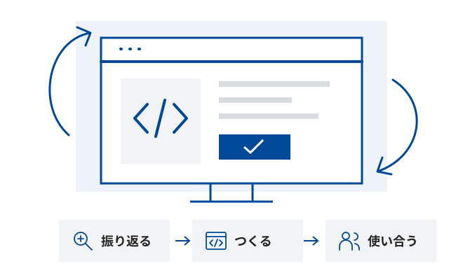
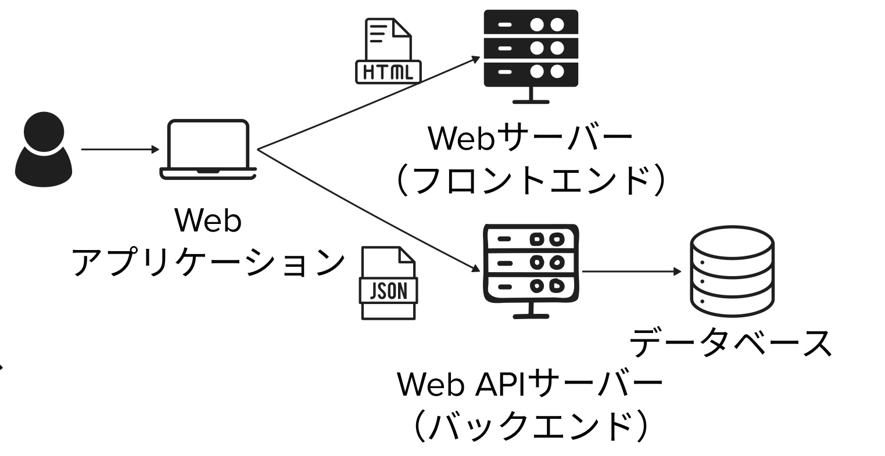

# 総合演習 ② ― 自由制作から、最終発表へ

2026年度・第7回｜2026年11月13日｜プログラミング演習

[スライドを開く](index.html)

## 今日のゴール

- **磨く**：フィードバックを反映してアプリを改善する。
- **伝える**：実際の画面を使って全員が最終発表し、お互いに質問する。
- **仮提出する**：説明・動画・共有リンク・デプロイリンクをそろえる。

今回は100分×2コマです。コマ間の休憩は含みません。以下の時間は各限の開始を0分として示します。

### 目次

[TOC]

## 今日の道順

| 順番 | 時間 | テーマ |
| --- | --- | --- |
| 01 | 3限 0〜5分 | 前回からのつながり |
| 02 | 3限 5〜15分 | 最終課題と評価・提出方法 |
| — | 3限 15〜20分 | アンケート（終わった人から制作へ） |
| 03 | 3限 20〜100分 | 制作・改善と発表準備 |
| 04 | 4限 0〜90分 | 最終発表・仮提出 |
| 05 | 4限 90〜100分 | まとめ・アンケート |

## 第3限｜制作・改善（100分）

| 時間 | 内容 |
| --- | --- |
| 0〜5分 | 出席確認・前回の振り返り・今日の道順 |
| 5〜15分 | 最終課題・評価・提出方法の確認（10分） |
| 15〜20分 | アンケート（5分・終わった人から制作へ） |
| 20〜85分 | 制作・改善（65分） |
| 85〜100分 | 提出物作成・発表準備（15分） |

### 前回からのつながり（5分｜0〜5分）

出席コードをディスプレイに表示します。

第6回では、使う人と最初に作る機能を決め、最初の版を制作し、お互いのアプリを使って改善案を集めました。今日はその続きを進めます。

[第6回のスライド](../6_comprehensive_exercise/index.html)／[第6回の授業資料](../6_comprehensive_exercise/readme.md)

### 最終課題と評価・提出方法（10分｜5〜15分）

課題・提出物・評価・日程は、第6回の内容を引き継ぎます。

#### 最終課題：自由な発想でWebアプリを作る

生成AIを活用して、誰かに使ってもらいたいWebアプリを制作します。これまで作ったアプリの発展でも、新しいアイデアでも構いません。

第6回では、最初の版を動かし、他の人に使ってもらって改善点を見つけました。今日は制作・改善と最終発表に取り組みます。

#### 最終提出物（4つ）

| 提出物 | 記載・収録する内容 |
| --- | --- |
| アプリの説明 | <ul><li>アプリ名</li><li>説明（200〜300文字程度・300文字以内）<ul><li>目的：誰が・どんな場面で使う？</li><li>主な機能：アプリで何ができる？</li></ul></li><li>処理の流れ</li></ul> |
| Webアプリケーションのキャプチャ動画 | 主な操作と、その結果がわかる画面録画 |
| Google AI Studioの共有リンク | 制作したアプリの共有リンク。共有設定とリンクから開けることを確認する |
| デプロイリンク（公開URL） | 公開URLから、ほかの人がアクセスして利用できることを確認する |

#### アプリの説明に記載する内容

次の3項目を記載しましょう。

- **アプリ名**：制作したアプリの名前。
- **概要説明（300文字以内）**：目的（誰が・どんな場面で使う？）と主な機能（アプリで何ができる？）をまとめる。
- **処理の流れ**：ユーザーの操作から処理結果が画面に表示されるまでを、**「担当：処理内容」**の形式で時系列に記述する。

担当は必要に応じて、ユーザー、フロントエンド、バックエンド、認証サービス、データベース、API、AIモデル（LLM）などを使います。自分のアプリの実際の処理を書きましょう。アプリ名と処理の流れは概要説明の文字数に含めません。

#### 処理の流れの書き方

ユーザーの操作から結果が画面に表示されるまでを、時系列で記述します。各行は **「担当：処理内容」** の形式にし、自分のアプリで実際に使っている担当と処理を書きましょう。

担当の例：ユーザー、フロントエンド、バックエンド、認証サービス、データベース、API、AIモデル（LLM）。

#### 処理の流れの記述例：ChatGPT

仕組みを理解するための簡略例です。ChatGPTの実際の内部構成を示すものではありません。

1. **ユーザー：**質問を入力する。
2. **フロントエンド：**質問をAPI経由でバックエンドに送る。
3. **バックエンド：**ユーザー認証や利用権限を確認する。
4. **データベース：**会話履歴やユーザー設定を返す。
5. **バックエンド：**質問と会話履歴をまとめ、AIへの入力を組み立てる。
6. **API：**AIモデルの推論サービスにリクエストを送る。
7. **AIモデル（LLM）：**回答を生成する。必要に応じて外部APIを使う。
8. **API：**生成された回答をバックエンドに返す。
9. **バックエンド：**回答を整え、会話履歴をデータベースに保存する。
10. **バックエンド：**API経由でフロントエンドに回答を返す。
11. **フロントエンド：**回答を画面に表示する。
12. **ユーザー：**回答を確認し、必要に応じて追加の質問を入力する。

### 成績評価・提出方法

#### 成績評価の基準

相対評価のため、各項目の点数は記載しません。

| 項目 | 確認する内容 |
| --- | --- |
| Firestoreの活用 | **データを保存・読み出し**、画面や機能に反映できる |
| Authenticationの活用 | **ログイン・ログアウト**が動き、状態に応じた機能や表示がある |
| マイク／カメラ／Gemini API／外部APIの活用 | **いずれかをアプリの機能や体験に活かしている** |
| デプロイ・公開 | 公開URLから、ほかの人がアクセスして利用できる |
| アプリの動作 | 目的に沿った主な操作を、**開始から結果まで実演**できる |
| アイデアの意図の伝わりやすさ | 説明文から、誰が・どんな場面で使い、何ができるアプリかを理解できる |
| アプリの処理への理解度 | 処理の流れで、入力から結果が表示されるまでの処理を説明できる |
| 利用規約の作成 | **アプリ内に利用規約を記載**し、**AIの限界・入力情報の扱い・禁止事項**などを利用者に伝える |

[第3回「AIの活用と倫理」](../3_ai_ethics/readme.md)で考えたリスクを、今回のアプリの利用規約に反映しましょう。

技術は、設定だけでなくアプリ内で実際に使えているかを確認します。Gemini APIの活用は、開発時にAIへコード生成を頼むこととは別です。

#### 制作・発表・提出の日程

| 時期 | 取り組むこと |
| --- | --- |
| 第6回(11/6) 4限 | 制作・実装、相互体験と改善 |
| 第7回(11/13) 3限 | 制作・改善の作業時間 |
| 授業時間以外 | 追加の時間が必要な場合は宿題として進める |
| 第7回(11/13) 4限 | 全員発表・仮提出（説明・動画・共有リンク・デプロイリンク） |
| 11/20 | 最終締切。発表後の改善を反映して最終提出 |

提出先・ファイル名・締切時刻は別途案内します。第6回のSlack共有と、仮提出・最終提出は別です。

### 制作の前に、アンケートをお願いします（5分｜15〜20分）

ご協力をお願いします。**回答が終わった人から、制作・改善を始めてください。**

### 制作・改善（65分｜20〜85分）

アンケートへの回答が終わった人は、20分を待たずに始めて構いません。

前回もらった感想・改善案を読み返し、今日直すところを優先順に並べます。まずは一番重要な機能から取り組みましょう。

- **振り返る**：前回もらった感想・改善案を読み返す。
- **優先する**：今日直すところを、優先順に並べる。
- **絞る**：まずは一番重要な機能から取り組む。
- **残す**：変更する前の状態を残す。
- **少しずつ直す**：機能は1つずつ追加・修正する。
- **動かして確かめる**：ログイン・保存・公開URLからの動作を試す。

**実装 → 操作 → 確認**を繰り返します。つまずいたら、**操作手順・期待した結果・実際の結果・エラー表示**を整理して相談しましょう。

作ってきたAIとのチャットで、**「作ったものを仕様として整理して」**と伝えてみましょう。整理した**仕様を修正して、作り直してもOK**です。

### 提出物作成・発表準備（15分｜85〜100分）

- **説明を書く**：アプリ名・概要・処理の流れを書く。
- **動画を撮る**：主な操作と結果がわかる動画を撮る。
- **リンクを確かめる**：講師PCで開けるリンクを確認する。
- **目的を伝える**：誰向けで、何ができるかを短く伝える。
- **2分で実演する**：一番見せたい操作を選び、2分で試す。
- **工夫を言葉にする**：工夫した点・苦労した点を整理する。

未完成でも、**動いている部分**と、**これから改善したい点**を説明できるようにしましょう。

## 第4限｜最終発表・仮提出（100分）

| 時間（21名の場合） | 内容 |
| --- | --- |
| 0〜5分 | 出席確認・発表準備 |
| 5〜68分 | 最終発表（3分×21名＝63分） |
| 68〜90分 | 提出物作成・仮提出（22分） |
| 90〜95分 | まとめ・最終提出までの確認 |
| 95〜100分 | アンケートの回答確認（未回答の方） |

発表人数に応じて、発表と提出物作成の配分を調整します。

### 出席確認・発表準備（5分｜0〜5分）

出席コードをディスプレイに表示します。発表用のアプリのリンクを講師に共有し、講師PCで開けることを確認しましょう。

### 最終発表（3分／人）

- **アプリのリンクを講師PCで開き、その画面を見せながら話します**（パワーポイント等のスライドは不要です）。
- **1人3分：発表2分、質疑応答1分**。
- **全員が発表します**。
- 全員が質問します。**前の発表者は、次の発表で1つ以上質問**しましょう。

**発表アジェンダ（例）**

1. **アプリの説明・アピール**：主な操作と動作、一番伝えたい特徴を紹介する。
2. **工夫・苦労**：工夫したところ・苦労したところを話す。
3. **振り返り**：反省点・これからの改善を伝える。

### 提出物作成・仮提出（22分｜68〜90分・21名の場合）

説明・動画・Google AI Studioの共有リンク・デプロイリンクをそろえ、仮提出します。提出先・ファイル名・締切時刻は別途案内します。

- **説明と実装**：説明と、実際の画面・処理が合っているか。
- **操作と結果**：動画で主な操作と結果がわかるか。
- **他の人のアクセス**：ほかの人がリンクから開けるか。

### 最終提出

説明・動画・リンクを最新版にそろえ、**11/20までに最終提出**します。

## アンケートがまだの方は、回答をお願いします（5分｜4限 95〜100分）

まだ回答していない方は、ご協力をお願いします。
